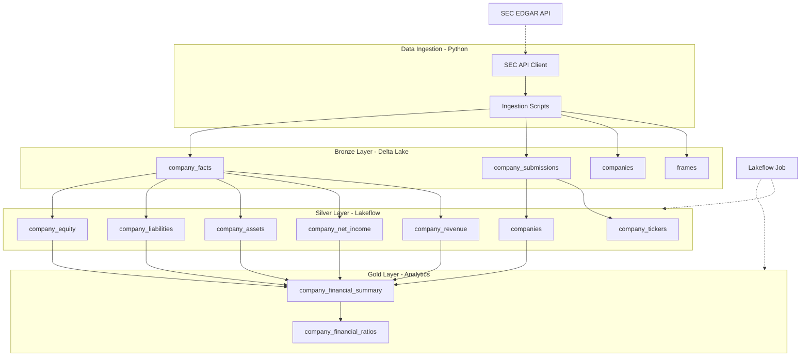
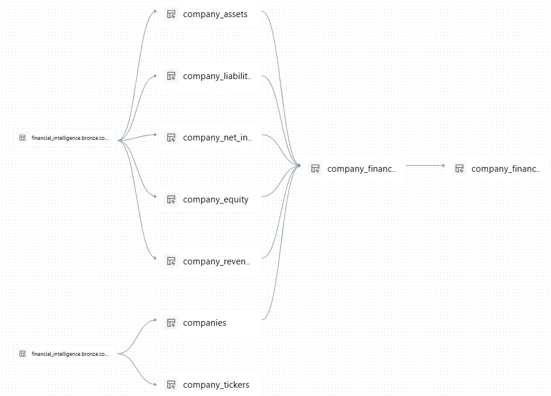
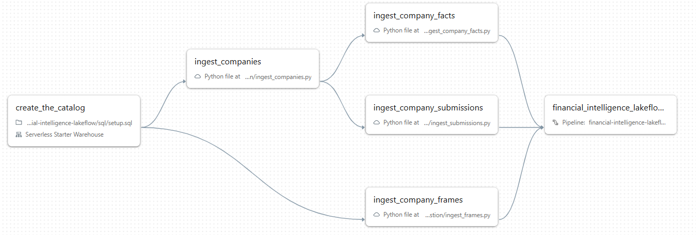

# Financial Intelligence — SEC EDGAR Data Pipeline


An end-to-end data engineering pipeline that ingests financial data from the SEC EDGAR API into a medallion architecture (Bronze → Silver → Gold) on Databricks, and produces clean, audited annual financial summaries and financial ratios per company and fiscal year (2021–2025).

The project is implemented with **PySpark**, **Lakeflow Spark Declarative Pipelines** (materialized views with declarative dependencies), **Lakeflow Jobs** for orchestration, **Delta Lake** storage, and **Unity Catalog** governance.

---

## Project Overview

Public companies registered with the SEC report their financial results through structured XBRL data. This pipeline:

* Ingests company metadata, filing submissions, and IFRS financial facts from the SEC EDGAR REST API.
* Stores raw API payloads unchanged in the Bronze layer for full reproducibility.
* Parses and normalizes the payloads in the Silver layer into typed Spark tables.
* Derives a Gold layer with one consolidated financial summary and a set of financial ratios per company and fiscal year, with data-quality enforcement (Lakeflow Expectations) and DECIMAL-accurate arithmetic.

Current scope (verifiable in the data): ~10,000 SEC-registered companies in the bronze directory (7,952 with parsed submissions in the Silver company dimension) and 1,375 company-year rows in the Gold layer. Gold values were spot-checked against published reports (e.g., Shell plc revenue FY2022 ≈ 381.3 bn USD).

---

## Architecture (Bronze, Silver, Gold)

The pipeline follows the medallion architecture. Raw SEC payloads land in Bronze as plain JSON strings; Silver extracts typed facts from those payloads; Gold consolidates them into analytics-ready tables.



**Declarative pipeline dependency graph (Lakeflow UI):**



### Bronze — raw SEC EDGAR ingestion

* One table per API endpoint, each row keeping the **raw, unmodified JSON payload** as a string plus ingestion metadata (`ingested_at`, `source_url`).
* `bronze.companies` — one row per registered company (CIK).
* `bronze.company_submissions`, `bronze.company_facts` — one payload row per company.
* `bronze.frames` — one payload row per taxonomy/tag/unit/period combination.
* All ingestion steps are **idempotent**: writes go through a shared `upsert()` helper that creates the table on first run and then MERGEs on the natural key, so re-runs never duplicate rows.

### Silver — cleaning and financial fact extraction

Seven materialized views, all defined in one Lakeflow Spark Declarative Pipeline:

* `silver.companies` — company dimension (one row per CIK) parsed from the submissions payload: sector code, filer category, fiscal year end (split into month/day), business address, etc.
* `silver.company_tickers` — one row per ticker/exchange pair, exploded from the parallel `tickers[]`/`exchanges[]` arrays.
* Five financial fact tables parsed from the companyfacts payload — IFRS taxonomy (`ifrs-full`), unit USD, one row per originally reported filing entry:
  * `company_assets`, `company_liabilities`, `company_equity` (instant/balance-sheet measures)
  * `company_revenue`, `company_net_income` (duration measures with `period_start`/`period_end`)

Silver keeps **all original filings**, including amended reports (40-F/A, 20-F/A, 6-K/A) and repeated filings for the same period — no arbitrary selection happens before Gold. `fiscal_year` is derived from the period end date and limited to 2021–2025.

### Gold — financial summaries and ratios

* `gold.company_financial_summary` — one row per `(cik, fiscal_year)` with `revenue`, `net_income`, `assets`, `liabilities`, `equity` as `DECIMAL(20,2)`.
* `gold.company_financial_ratios` — one row per `(cik, fiscal_year)` with four key ratios as `DECIMAL(20,6)`.

See [Gold Layer and Financial Analytics](#gold-layer-and-financial-analytics) for the selection rule and ratio definitions.

---

## Technology Stack

| Technology | Used for |
| --- | --- |
| Python / PySpark | Ingestion modules, Spark transformations |
| Databricks | Compute platform (serverless Spark, SQL warehouse) |
| Delta Lake | Table format for all bronze/silver/gold tables |
| Unity Catalog | Governance and the `financial_intelligence` catalog |
| Lakeflow Spark Declarative Pipelines | Silver and Gold materialized views with managed dependencies |
| Lakeflow Jobs | End-to-end orchestration (ingestion → pipeline) |
| SQL | Catalog/schema setup, ad-hoc analysis |
| Git / GitHub | Version control of the project source |

---

## Data Source: SEC EDGAR API

The pipeline consumes the structured JSON APIs of [SEC EDGAR](https://www.sec.gov/search-filings/edgar-application-programming-interfaces):

* `company_tickers.json` — the full company directory (ticker ↔ CIK mapping).
* `submissions/CIK##########.json` — all filings submitted by one company.
* `api/xbrl/companyfacts/CIK##########.json` — all XBRL facts reported by one company (the primary source of the financial facts).
* `api/xbrl/frames/{taxonomy}/{tag}/{unit}/{period}.json` — one concept across all companies for one period (ingested to Bronze; not currently consumed downstream).

The financial facts are taken from the **IFRS taxonomy (`ifrs-full`)**, unit **USD**. SEC API policy requires a descriptive `User-Agent` header (configured in `ingestion/common.py`) and a request rate below 10 req/s — the client enforces both.

---

## Data Ingestion and Transformation

All ingestion lives in `ingestion/` as standalone Python modules (`spark` in scope), each idempotent and independently runnable:

* **`sec_client.py`** — a pure HTTP client with:
  * SEC-compliant `User-Agent` validation,
  * client-side **rate limiting** (throttled below 10 req/s, default 8),
  * 30 s timeouts and **automatic retries** on 403/429/5xx and network errors with exponential backoff (2 s → 4 s → 8 s, up to 6 attempts),
  * a dedicated `SECClientError` for exhausted retries and invalid JSON.
* **`bronze_schema.py`** — explicit Spark schemas for the four bronze tables; payloads stay raw JSON strings so Silver can always be rebuilt without re-hitting the API.
* **`common.py`** — shared configuration (catalog, tables, API tags/periods) and the `upsert()` MERGE helper.
* **`ingest_companies.py` / `ingest_submissions.py` / `ingest_company_facts.py` / `ingest_frames.py`** — the four ingestion steps.

Notable engineering decisions:

* **Per-entity fault isolation** — a failing CIK or frame combination is logged and skipped; the rest of the run continues and the failure is picked up on the next run.
* **Batched ingestion** — companyfacts payloads are large (MBs each); they are fetched and MERGEd in batches, so progress is visible mid-run and a cancelled run keeps already-written batches.
* **Cheap pre-filtering in Silver** — payloads without IFRS facts are excluded by a string pre-filter before an expensive `from_json` parse.
* **Deduplication** — `dropDuplicates` at every layer; the ingestion source is deduplicated on its merge key (e.g. one row per CIK, since `company_tickers.json` lists one entry per ticker).

---

## Pipeline Orchestration

Two levels of orchestration are used:

1. **Lakeflow Job `financial-job`** orchestrates the full run end-to-end:

   | Task | Depends on | Action |
   | --- | --- | --- |
   | `create_the_catalog` | — | Runs `sql/setup.sql` (creates catalog + bronze/silver/gold schemas) on a SQL warehouse |
   | `ingest_companies` | `create_the_catalog` | Loads the company directory |
   | `ingest_company_frames` | `create_the_catalog` | Loads XBRL frames (runs in parallel to the company ingestion) |
   | `ingest_company_submissions` | `ingest_companies` | Loads submissions for all CIKs from `bronze.companies` |
   | `ingest_company_facts` | `ingest_companies` | Loads XBRL facts for all CIKs |
   | `financial_intelligence_lakeflow_pipeline` | all ingestion tasks | Runs the declarative pipeline |

2. **Lakeflow Spark Declarative Pipeline** (serverless, Photon) defines the Silver and Gold materialized views. Its source is the whole `transformations/**` tree; the pipeline resolves the **MV dependencies automatically** (`companies`/`company_tickers` read `bronze.company_submissions`; the five fact MVs read `bronze.company_facts`; the Gold summary reads the fact MVs and `silver.companies`; the ratios MV reads the Gold summary). MVs refresh incrementally where possible, and the pipeline publishes everything to Unity Catalog under `financial_intelligence.silver` / `financial_intelligence.gold`.

Task dependency graph of `financial-job`:




---

## Data Quality and Expectations

* **Lakeflow Expectation on the Gold summary** — `expect_or_drop("valid_balance_sheet", ...)` drops rows where `assets ≠ liabilities + equity` exactly, guaranteeing the Gold layer only contains internally consistent balance sheets. Rows whose three balance-sheet values stem from different filings are intentionally dropped.
* **NULL-safe division** in the ratios MV — a ratio stays `NULL` whenever the numerator or denominator is `NULL`, or the denominator is `0`; no runtime errors, no `NaN`/`Infinity` values in the output.
* **NULL-tolerant joins** — all Silver→Gold joins are LEFT joins, so companies are never silently dropped because a fact is missing; missing facts stay `NULL`.
* **Typed, explicit schemas** — every MV declares its schema; monetary values are `DECIMAL(20,2)` and ratios `DECIMAL(20,6)` for exact financial arithmetic.

**Data quality screenshot:**

> _Placeholder — Lakeflow pipeline event log showing the `valid_balance_sheet` expectation metrics on the latest update._

---

## Gold Layer and Financial Analytics

### `gold.company_financial_summary`

One row per `(cik, fiscal_year)` with `revenue`, `net_income`, `assets`, `liabilities`, `equity`. When a company filed multiple reports for the same period, a deterministic selection rule picks one value:

1. **Duration facts** (revenue, net income): only complete fiscal-year periods of **300–400 days**.
2. **Instant facts** (assets, liabilities, equity): the balance-sheet value at the fiscal-year-end date.
3. **Latest filing wins** — ordered by `filed` desc, tie-broken by accession number desc, then value desc (full determinism).
4. `fiscal_year` is always `year(period_end)` — the XBRL fiscal-year label is never trusted.

USD and the 2021–2025 fiscal-year range are already guaranteed by Silver; Gold does not duplicate those filters.

### `gold.company_financial_ratios`

Derived 1:1 from the summary:

| Ratio | Formula |
| --- | --- |
| `net_profit_margin` | `net_income / revenue` |
| `equity_ratio` | `equity / assets` |
| `debt_ratio` | `liabilities / assets` |
| `return_on_assets` | `net_income / assets` |

All ratios are stored as `DECIMAL(20,6)` and are `NULL`-safe (missing inputs or zero denominators yield `NULL`).

---

## Repository Structure

```text
financial-intelligence-lakeflow/
├── ingestion/                        # Standalone ingestion modules (run by the Lakeflow job)
│   ├── sec_client.py                 #   SEC EDGAR HTTP client (rate limit, retries)
│   ├── bronze_schema.py              #   Explicit Spark schemas for the bronze tables
│   ├── common.py                     #   Shared config + idempotent upsert() MERGE helper
│   ├── ingest_companies.py           #   company_tickers.json -> bronze.companies
│   ├── ingest_submissions.py         #   submissions -> bronze.company_submissions
│   ├── ingest_company_facts.py        #   companyfacts -> bronze.company_facts (batched)
│   └── ingest_frames.py              #   xbrl frames -> bronze.frames
├── transformations/                  # Declarative pipeline source (one dataset per file)
│   ├── silver/                       #   7 silver MVs (dimension, tickers, 5 IFRS fact tables)
│   └── gold/                          #   company_financial_summary + company_financial_ratios
├── sql/
│   └── setup.sql                     # Catalog + schema creation (job task 1)
├── images/                            # Screenshots (job DAG, pipeline dependency graph)
└── README.md
```

---

## Setup and Execution

### Prerequisites

* A Databricks workspace with **serverless compute** and a **SQL warehouse**.
* Unity Catalog permissions to create a catalog and schemas.
* A SEC-compliant **User-Agent** (`"Company Name email@example.com"`) — set it in `ingestion/common.py`. The current value is a placeholder for this portfolio project and should be replaced with your own.

### Steps

1. Add the repository to your Databricks workspace (Git folder or upload).
2. Create a **Lakeflow Spark Declarative Pipeline** with source `financial-intelligence-lakeflow/transformations/**`, catalog `financial_intelligence`, and Photon + serverless compute enabled.
3. Create a **Lakeflow Job** with the six tasks described in [Pipeline Orchestration](#pipeline-orchestration) (one SQL task for `sql/setup.sql`, four Spark Python tasks for the ingestion modules, one pipeline task).
4. Run the job — it creates the catalog/schemas, ingests the bronze layer, and refreshes the silver/gold pipeline in one go.

The catalog and schemas can also be created manually by running `sql/setup.sql` on any SQL warehouse, and each ingestion module can be run standalone (`spark` in scope) during development.
